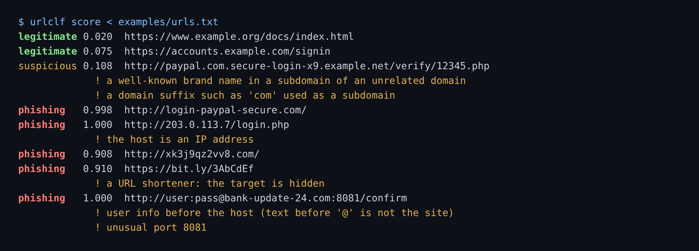

# urlclf

[](https://github.com/TexAlphaWolf/sec-phishing-url-classifier/actions/workflows/ci.yml)
[](https://github.com/TexAlphaWolf/sec-phishing-url-classifier/actions/workflows/codeql.yml)


Scores a URL for phishing **from its text alone**, never opening it. A small linear model over the domain name (character 3-grams and eighteen hand-made features), stored as plain JSON and scored in pure Python, with plain-rule warnings for the tricks the model does not read. Most of the work is in the evaluation: the public dataset it is measured on lets a model reach 99.9% by learning *how the data was collected*, and this project found and removed those shortcuts one by one.



*Made-up names; nothing is fetched or resolved. A score under the threshold with a rule warning is "suspicious"; with no warning it is "legitimate", which means "no sign found", not "safe".*

## Use it

```bash
pip install .                                   # scoring needs no third-party package
urlclf score "http://login-paypal-secure.com/"
urlclf score --explain --top 3 URL...           # what moved each score most
urlclf score - < urls.txt --format json         # one URL per line
urlclf score --fail-on-phishing URL             # exit status 1 if flagged, for a pipeline
urlclf serve                                    # local JSON API on 127.0.0.1:8080
```

```bash
curl -s -X POST localhost:8080/score -d '{"urls": ["http://203.0.113.7/login.php"]}'
```

With Docker, nothing is installed on the machine:

```bash
docker build -t urlclf .
docker run --rm urlclf score "http://login-paypal-secure.com/"
```

Train your own model (needs `pip install ".[train]"` and a CSV with a URL column and a label column):

```bash
urlclf synth --out made-up.csv                 # made-up URLs, to try the pipeline only
urlclf train --data made-up.csv --out model.json
urlclf score --model model.json URL
```

## What it does

- **Reads the registrable domain.** `a.b.example.co.uk` is scored as `example.co.uk`. The path, the query, the scheme, `www.` and other subdomains are ignored on purpose ([why](docs/limitations.md)).
- **Features:** length, digits, hyphens, entropy, vowel ratio, longest consonant run, digit/letter switches, repeated letters, keywords (`login`, `verify`, ...), a brand name stuck onto a name (`paypal-secure`), suffix depth, IP host, punycode, user info, odd port, URL shorteners; plus hashed character 3-grams of the name and the suffix.
- **Warnings by rule**, shown next to the score: a brand or `com` in a subdomain of an unrelated domain, `@` before the host, an IP, an unusual port, punycode, a shortener, four or more subdomain levels.
- **Safe to run on hostile input.** A URL is cut at 4,096 characters, never fetched, and printed with control characters replaced. The model file is JSON checked field by field: nothing is unpickled, so opening a model cannot run code. 20,004 damaged URLs went through scoring with no exception.
- **Explainable:** `--explain` lists the features and 3-grams that pushed the score, in log-odds.

## Measured

Everything below is on PhiUSIIL (UCI #967, 235,795 URLs), split **by site** so no domain is on both sides, with the feature set, `C` and threshold chosen on a validation part and the test part read once. Method, tables, and the story of the shortcuts: [docs/evaluation.md](docs/evaluation.md). The unedited report: [docs/report.json](docs/report.json).

| Measure (test part, 32,853 URLs) | Value |
|---|---|
| ROC AUC | **0.883** |
| Recall at a 1% false-positive budget | **52.2%** (51.3 - 53.1%) |
| False-positive rate reached | 1.07% (0.93 - 1.22%) |
| Precision (on the test part's 39% phishing) | 96.9% |

**This is a first filter, not a detector.** About half of the phishing hosts in the test data, with about 1 in 100 legitimate (popular) domains flagged. In real traffic, where phishing is rare, roughly two flagged URLs in three would be false alarms. It cannot see a page, a path, or a phishing page on a legitimate host.

| How the number fell as the shortcuts came out | AUC | Recall |
|---|---|---|
| the whole URL, path included | 0.999 | 99.7% |
| origin only (scheme, host, port) | 0.984 | 93.6% |
| scheme removed from lengths and ratios too | 0.910 | 65.4% |
| **registrable domain only (final)** | **0.883** | **52.2%** |

In that dataset every legitimate URL is `https`, starts with `www.`, has no path and almost never a subdomain, so each of those became a "phishing sign". The scheme alone, with no other information, finds 55% of the phishing with no false positive. None of these holds on the web. Details and the other limits: [docs/limitations.md](docs/limitations.md).

Other checks, all re-run by CI: the saved JSON model scores exactly like the scikit-learn model it came from (log-odds differ by about 1e-14, for all seven feature sets), a split never puts one site on two sides, and the pipeline runs end to end on made-up data. The test suite (coverage over 90%) runs on Python 3.11 to 3.14 and on Windows; it also checks that this page, the evaluation, the report and the bundled model agree.

## Layout

```
src/urlclf/   features.py (what is read)   model.py (JSON model, scoring)   train.py (fit, select, report)
              data.py (CSV, cleaning, split by site)   metrics.py   serve.py   cli.py   psl.py
tools/        evaluate.py (offline measurements)   screenshot.py
docs/         evaluation.md   limitations.md   report.json
```

The dataset is not in the repository (CC BY 4.0, download it from [UCI](https://archive.ics.uci.edu/dataset/967)); `docs/evaluation.md` has the command that reproduces the report in about eleven minutes. The Public Suffix List snapshot (Mozilla, MPL-2.0) is bundled.

## Licence

MIT. Dataset: PhiUSIIL Phishing URL Dataset, CC BY 4.0, Prasad & Chandra.
